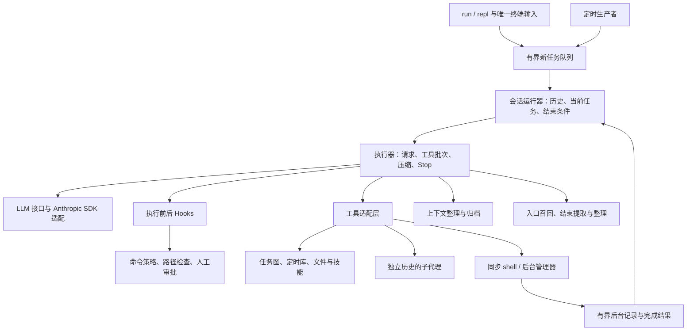

# 阶段一：全局架构调查

审查日期：2026-10-16。基线、原有工作区修改及逐文件清单见 [覆盖记录](00-coverage.md)。本阶段只确认结构，不将后续待核查的风险当作定论。分析对象是工作区源码，不是旧 JAR 或历史验收记录。

## 当前架构是什么

JadeCode 是 Java 21 的 Maven 单模块 CLI。它通过模型决定下一步，再由程序检查权限、运行工具、保存结果并决定是否继续。当前已有上下文保护、工作区记忆、持久任务图、子代理、后台命令和进程内定时交付；README 列出的团队、MCP、workflow 和 goal 属于后续规划，仓库没有对应产品实现。

最重要的结构变化是：整个会话由一个消费者保存历史。输入线程和定时线程只提交新任务，后台线程只保存结果并唤醒消费者。消费者一次处理一个任务；等待任务必需的后台结果时也不领取下一项。模型调用和普通工具仍同步执行，事件对象用于统一采用结果，并不意味着全面异步。

## 实际模块及职责

| 模块 | 负责什么 | 主要依赖和边界 |
| --- | --- | --- |
| Main、cli、config、util | 组装对象、解析命令、终端输入输出、配置和 JSON | Main 是装配入口；CLI 创建并关闭会话 |
| agent | 新任务排队、当前任务状态、采用历史、请求与工具执行 | 历史属于 SessionRuntime；AgentLoop 是执行器 |
| llm、messages | 产品自己的消息结构与 SDK 转换 | SDK 类型主要隔离在适配器；消息封闭为三种块 |
| tools、safety | 工具接口、分发、输入检查、权限、hooks | 权限目前通过装配的 PreToolUse hook 接入 |
| context | 请求前保护、手工/主动/超限压缩、长结果转存 | 不拥有会话目标或消息列表；返回替代历史 |
| memory | 扫描记忆、选择背景、提取及数量触发整理 | 只接入父任务生命周期，不混入正式模型回复 |
| subagent、skills、todo | 子任务隔离、按需知识、当前步骤展示 | 子代理六工具、30 轮限制；todo 与持久任务不同 |
| tasks | 文件持久任务图、依赖、认领和解锁 | 不自动调度，也不恢复真实执行断点 |
| BackgroundManager、ShellCommand | 启动命令、限制输出、取消、归属与结果确认 | 运行进程与未确认结果共用容量限制 |
| cron、CronProducer | 分钟匹配、durable pending、排队、有限退避 | 仅 live REPL 自动触发；首个正式模型回复确认送达 |

## 六条关键链路

1. **人工请求**：终端读取 → submit 分配可信身份 → FIFO → 入口 hook → 加入请求 → 保存原目标 → 召回记忆 → 请求模型。
2. **工具交换**：检查正式回复 → 写入完整工具调用 → 逐项权限与执行 → 整批结果回灌 → 必要时压缩 → 再问模型。执行意外失败时为剩余调用补结果，避免下次请求留下悬空调用。
3. **后台等待**：bash 返回启动回执 → 模型可做其它工作 → 无工具回复时检查必等命令 → 等待结果事件 → 以普通参考通知进入历史 → 模型收到后确认结果记录。启动和完成不复用同一工具调用 ID。
4. **定时交付**：每秒检查分钟规则 → pending 持久化 → 进程内防重复领取 → 新任务排队 → 首个合法正式回复确认 → 执行业务工具。首回复前失败可恢复历史并有限重投；首回复后失败不重做整项业务。
5. **上下文保护**：每次正式请求前整理 → 必要时先归档、再摘要、替换历史 → 明确超限错误再有限补救。摘要请求不执行工具、不算正式交付。
6. **完成与退出**：无工具、无待处理必等结果、Stop 放行 → 记忆维护 → 最终回答。退出则关定时生产、标记执行器关闭、停止 shell、拒绝排队任务并中断消费者；不承诺撤销文件副作用或立即停止网络请求。

## 初步结构评价

较好的部分是单消费者、独立的消息模型、可注入客户端、父子历史隔离，以及对“启动、交付、完成、成功”的明确区分。当前不需要微服务、外部消息队列或全面异步化。

包依赖并非严格分层：agent 依赖 tools/safety，tools/safety 又依赖 agent 的任务上下文；llm 依赖工具对象，工具层又通过子代理依赖 llm。这些是源码可见的包环，但是否值得改动，要看具体职责和扩展成本，不能仅凭环就判定运行缺陷。

下一步重点检查：审批是否覆盖真实 shell 能力；历史压缩是否保护所有最新输入；多个文件写入是否会留下半成品；后台取消是否存在进程与管理器的时间差；异常是否会被误当成正常结束；新增模块是否仍能利用现有测试入口。

## 实际审查顺序与交付计划

| 阶段 | 顺序和核查目标 | 产物 |
| --- | --- | --- |
| 二 | 会话/执行控制 → LLM/协议 → 工具/安全/hooks → shell/后台 → 压缩 → 记忆 → 子代理/技能/todo → 任务图 → cron → 入口/配置 | 每组独立模块报告，问题统一用 ARCH 编号 |
| 三 | 重走任务入口、工具闭合、压缩、后台恢复、cron 确认、关闭链；检查测试结构和文档漂移 | 跨模块报告、工程质量报告 |
| 四 | 重要证据复读、寻找反例、合并问题、排依赖和优先级、核对覆盖与写入边界 | 综合报告、最终覆盖记录 |

## 源码证据

下列位置均相对仓库根，行号来自当前工作区。

- `src/main/java/com/jadecode/Main.java:136–227`：装配父十八工具、子六工具及共享组件；`:360–404`：父子提示词。
- `src/main/java/com/jadecode/agent/SessionRuntime.java:119–169,204–309,365–417,509–529`：生产者入口、状态推进、历史采用、失败和退出。
- `src/main/java/com/jadecode/agent/AgentLoop.java:253–288,307–403`：请求、工具批次、压缩、Stop、记忆维护。
- `src/main/java/com/jadecode/agent/SessionInbox.java:38–103`：64 项 FIFO、唤醒修订号和关闭。
- `src/main/java/com/jadecode/agent/CronProducer.java:61–161`：定时生产、首回复确认和退避。
- `src/main/java/com/jadecode/cli/RunCommand.java:42–60`、`cli/ReplCommand.java:31–49`：两入口共用运行器，只有 REPL 启动 cron。
- `src/main/java/com/jadecode/llm/AnthropicSdkLlmClient.java:40–68,74–180`：SDK 边界。
- `pom.xml:17–163`、`jade:1–16`：Java 21、依赖、toolchain、shade 和启动方式。未运行这些脚本。

阶段一完成。后续报告将区分源码已证实的行为、有条件的风险、待运行验证和可选设计改进。
